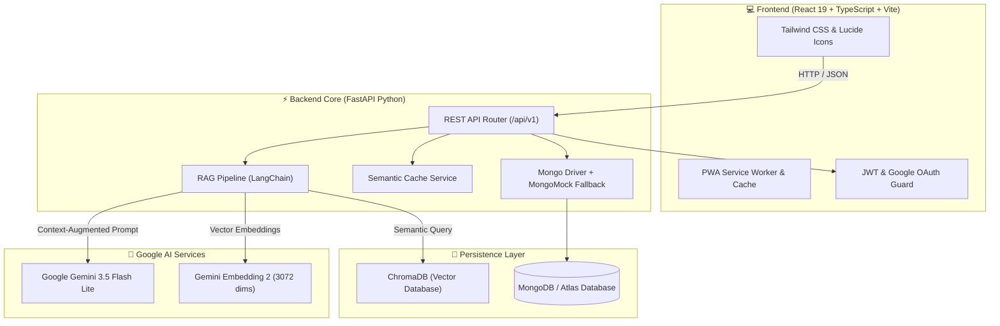

<div align="center">

# 🎓 AI Intelligent Student Learning Companion

**Next-Generation Personalized Academic Copilot Powered by Google Gemini, RAG & Vector Search**

[](https://github.com/NagarajuMudhiraj/AI-Intelligent-Student-Learning-Companion/stargazers)
[](https://github.com/NagarajuMudhiraj/AI-Intelligent-Student-Learning-Companion/network/members)
[](https://opensource.org/licenses/MIT)
[](CONTRIBUTING.md)

[](https://www.python.org/)
[](https://fastapi.tiangolo.com/)
[](https://react.dev/)
[](https://www.typescriptlang.org/)
[](https://aistudio.google.com/)
[](https://www.trychroma.com/)
[](docker-compose.yml)
[](https://web.dev/progressive-web-apps/)

<p align="center">
  <a href="#-key-features">Key Features</a> •
  <a href="#-architecture">Architecture</a> •
  <a href="#-1-click-docker-run">1-Click Docker</a> •
  <a href="#-local-development">Local Setup</a> •
  <a href="#-cloud-deployment">Cloud Deploy</a> •
  <a href="#-api-reference">API Reference</a> •
  <a href="#-roadmap">Roadmap</a> •
  <a href="#-contributing">Contributing</a>
</p>

</div>

---

## 💡 What is AI Student Learning Companion?

Modern students face information overload across dense textbooks, lecture slide decks, and disparate PDF notes. Passive reading rarely leads to high retention.

**AI Intelligent Student Learning Companion** bridges this gap by converting static academic materials into an active, conversational, and tailored learning environment:
1. **Document Grounding (RAG):** Upload textbooks or lecture slides and chat directly with an assistant that quotes your exact syllabus.
2. **Instant Self-Testing:** Automatically turn lecture notes into interactive multiple-choice quizzes and 3D study flashcards.
3. **Structured Timetables:** Automatically generate dynamic study schedules based on exam dates and chapter complexity.
4. **Career Alignment:** Map studied subjects to high-demand industry careers and recommended skill milestones.

---

## 🚀 Key Features

| Feature | Description | Tech Highlight |
|---|---|---|
| 📚 **Smart RAG Hub** | Upload `PDF`, `DOCX`, `PPTX`, `TXT`. Instant chunking and semantic vector storage. | PyMuPDF, ChromaDB, Gemini Embeddings |
| 🤖 **AI Study Chat** | Chat with conversational memory grounded in uploaded notes with source citations. | Gemini 3.5 Flash Lite, LangChain |
| 📝 **Auto Quiz Generator** | Generate topic-specific or document-derived multiple-choice tests with detailed explanations. | Dynamic Bloom's Taxonomy, Pydantic |
| 🗂️ **Interactive 3D Flashcards** | Spaced-repetition flip cards for definitions, formulas, and critical concepts. | CSS 3D Transforms, Local Storage |
| 📅 **AI Study Planner** | Personalized week-by-week study timetables with milestone tracking. | Automated task scheduling |
| 💼 **Career & Skills Advisor** | Evaluates course materials to suggest aligned career paths and learning roadmaps. | Gemini AI curriculum analysis |
| 📊 **Learning Analytics** | Real-time performance dashboards tracking study consistency and quiz scores. | Visual charts & PDF export |
| 📱 **Progressive Web App** | Install directly onto desktop, Android, or iOS with offline caching. | Vite PWA Plugin, Service Workers |

---

## 🏗️ Architecture



> 📐 **Interactive Architecture View:** Explore the comprehensive system diagram with live node inspections in [`student-companion-architecture.html`](student-companion-architecture.html).

---

## 🐳 1-Click Docker Run

The easiest way to get the entire full-stack application running with one command:

### 1. Clone & Set Environment
```bash
git clone https://github.com/NagarajuMudhiraj/AI-Intelligent-Student-Learning-Companion.git
cd AI-Intelligent-Student-Learning-Companion
cp .env.example .env
```
*Edit `.env` and paste your free [Google Gemini API Key](https://aistudio.google.com/).*

### 2. Start Containers
```bash
docker-compose up --build -d
```

### 3. Open Application
- 🖥️ **Frontend Web App:** [http://localhost:5173](http://localhost:5173)
- ⚙️ **FastAPI Backend:** [http://localhost:8000](http://localhost:8000)
- 📖 **Interactive Swagger API Docs:** [http://localhost:8000/docs](http://localhost:8000/docs)

To stop the containers:
```bash
docker-compose down
```

---

## 💻 Local Development

### 1. Prerequisites
- **Python 3.10+**
- **Node.js 18+ (Node 20 recommended)**
- **Google Gemini API Key** ([Get free key here](https://aistudio.google.com/))
- *(Optional)* MongoDB running locally or a MongoDB Atlas URI (if omitted, the backend automatically uses an built-in in-memory database).

---

### 2. Backend Setup

```bash
cd backend

# Create virtual environment
python -m venv venv

# Activate virtual environment
# Windows:
venv\Scripts\activate
# macOS/Linux:
source venv/bin/activate

# Install dependencies
pip install -r requirements.txt

# Configure environment
cp .env.example .env
# Edit backend/.env and insert your GEMINI_API_KEY

# Start server with live reload
uvicorn app.main:app --reload --host 127.0.0.1 --port 8000
```

---

### 3. Frontend Setup

```bash
cd frontend

# Install dependencies
npm install

# Configure environment
cp .env.example .env

# Start Vite dev server
npm run dev
```

Visit [http://localhost:5173](http://localhost:5173) in your browser.

---

## ☁️ Free Cloud Deployment

### Frontend ➔ Vercel
1. Fork this repository.
2. Go to [Vercel](https://vercel.com/) and click **Add New Project**.
3. Select your fork and set **Root Directory** to `frontend`.
4. Set Environment Variables:
   - `VITE_API_URL`: Your deployed backend URL + `/api/v1`
   - `VITE_GOOGLE_CLIENT_ID`: *(Optional)* Your Google OAuth Client ID
5. Click **Deploy**. SPA routing is pre-configured in `frontend/vercel.json`.

---

### Backend ➔ Render
1. Go to [Render](https://render.com/) and create a **New Web Service**.
2. Connect this repository (Render Blueprint `render.yaml` is pre-configured).
3. Set Environment Variables:
   - `GEMINI_API_KEY`: Your Google Gemini API Key
   - `MONGODB_URL`: Your MongoDB Atlas connection string (or use in-memory fallback)
   - `SECRET_KEY`: A 32-character random string for JWT security
4. Deploy service!

---

## 📡 API Reference

Explore the full interactive documentation at `/docs` (Swagger UI) or `/redoc` (ReDoc).

| Category | Method | Endpoint | Description | Auth Required |
|---|---|---|---|---|
| **Auth** | `POST` | `/api/v1/auth/register` | Register a new student account | No |
| **Auth** | `POST` | `/api/v1/auth/login` | Login with email/password and obtain JWT | No |
| **Auth** | `POST` | `/api/v1/auth/google` | Google One-Tap OAuth Login | No |
| **Documents** | `POST` | `/api/v1/documents/upload` | Upload & vectorize PDF, DOCX, PPTX, TXT | Yes |
| **Documents** | `GET` | `/api/v1/documents/` | List all uploaded documents for current user | Yes |
| **Documents** | `DELETE`| `/api/v1/documents/{doc_id}` | Remove document and its ChromaDB vector index | Yes |
| **Chat** | `POST` | `/api/v1/chat/message` | Context-aware RAG conversation grounded in notes | Yes |
| **Chat** | `GET` | `/api/v1/chat/history` | Retrieve previous conversation sessions | Yes |
| **Quiz** | `POST` | `/api/v1/quiz/generate` | Auto-generate multiple-choice quiz from topic/doc | Yes |
| **Quiz** | `POST` | `/api/v1/quiz/submit` | Submit answers and receive score + analysis | Yes |
| **Flashcards**| `POST` | `/api/v1/flashcards/generate`| Generate 3D study flashcards from syllabus | Yes |
| **Planner** | `POST` | `/api/v1/planner/generate`| Generate AI study schedule & milestones | Yes |
| **Career** | `POST` | `/api/v1/career/recommend`| AI recommendations for careers, skills & roadmap | Yes |
| **Analytics**| `GET` | `/api/v1/analytics/dashboard`| Aggregate study metrics & quiz history | Yes |

---

## 🗺️ Roadmap

- [x] **v1.0 (Core Release)**
  - [x] Multi-format document parser (PDF, DOCX, PPTX, TXT)
  - [x] RAG vector retrieval via ChromaDB and Google Gemini
  - [x] Automated quiz generator with customizable difficulty levels
  - [x] 3D flip-card study flashcard deck
  - [x] AI study planner and task scheduler
  - [x] Career pathway and industry skills advisor
  - [x] PWA offline caching & mobile install support
  - [x] In-memory database fallback for zero-config startup
  - [x] Full Docker & Docker Compose containerization
- [ ] **v1.1 (Upcoming)**
  - [ ] 🎙️ Voice Q&A Mode (Speech-to-Text & Text-to-Speech)
  - [ ] 📄 Direct export of study notes & quizzes to Notion / Markdown
  - [ ] 🌐 Multi-language translation for study materials
- [ ] **v2.0 (Planned)**
  - [ ] 👥 Collaborative study rooms and peer-to-peer flashcard sharing
  - [ ] 📊 Spaced Repetition Algorithm (SM-2 / Anki-style scheduling)
  - [ ] 📱 Native React Native iOS & Android application

---

## 📈 Star History

[](https://star-history.com/#NagarajuMudhiraj/AI-Intelligent-Student-Learning-Companion&Date)

---

## 🤝 Contributing

Contributions make the open-source community an amazing place to learn, inspire, and create. Any contributions you make are **greatly appreciated**!

1. Check our [Contributing Guide](CONTRIBUTING.md) for standards and setup instructions.
2. Read our [Code of Conduct](CODE_OF_CONDUCT.md).
3. Check open issues for [Good First Issues](https://github.com/NagarajuMudhiraj/AI-Intelligent-Student-Learning-Companion/issues).

---

## 👨‍💻 Author

**B. Nagaraju**  
*Computer Science and Engineering*  
*KLH University, Hyderabad*  
- GitHub: [@NagarajuMudhiraj](https://github.com/NagarajuMudhiraj)

---

## 📄 License

Distributed under the **MIT License**. See [`LICENSE`](LICENSE) for details.
